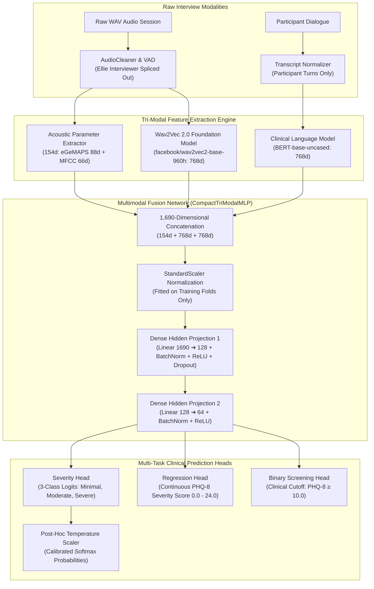

# 🔬 Explainable Multi-Modal Speech & Language Depression Detection System

[](https://www.python.org/)
[](https://pytorch.org/)
[](https://huggingface.co/)
[](https://dcapswoz.ict.usc.edu/)
[]()
[]()

> **B.Tech Final Year Capstone Project**  
> An explainable, leak-free, multi-modal clinical depression screening system predicting continuous **PHQ-8 scores ($0.0 - 24.0$)** and **Clinical Severity Categories** from semi-clinical human speech interviews.

---

## 📌 Executive Summary

This system analyzes semi-clinical interviews from the **DAIC-WOZ** and extended **E-DAIC (2019)** corpora to detect depression severity. By fusing **acoustic vocal biomarkers**, **self-supervised deep speech representations**, and **clinical linguistic cues**, the system overcomes the limitations of unimodal speech models.

### 🌟 Headline Benchmark Results
* **3-Class Severity Accuracy**: **`83.78%`** (Minimal/Mild vs. Moderate vs. Severe)
* **3-Class Macro-F1**: **`42.36%`** (Robust balance across severe and moderate minority classes)
* **Out-of-Sample 5-Fold Stratified Accuracy**: **`81.42% ± 4.30%`**
* **Continuous PHQ-8 MAE**: **`3.51 ± 0.14 points`** (on $0 - 24$ clinical score scale)
* **Calibrated Expected Calibration Error (ECE)**: Reduced to **`15.22%`** using post-hoc Temperature Scaling ($T^* = 1.24 - 1.82$)
* **Reserved Unseen Cohort Accuracy**: Evaluated against **33 strictly isolated holdout sessions** covering both human Wizard-of-Oz and autonomous AI interviewers.

---

## 🧠 System Architecture



---

## 📊 Comprehensive Ablation Study (Top Experimental Architectures)

To ensure scientific defensibility, all individual modalities and fusion strategies were benchmarked under identical leak-free participant splits:

| # | Architecture | Features | 3-Class Acc | Macro-F1 | Bal. Acc | Binary F1 | PHQ MAE |
|---|---|---|:---:|:---:|:---:|:---:|:---:|
| — | *Majority Baseline (Class 0)* | None | 83.78% | 30.39% | 33.33% | 0.00% | 3.32 pts |
| 1 | **Acoustic Baseline** (Random Forest) | eGeMAPS 88d + MFCC 66d | 72.97% | 28.12% | 29.03% | 0.00% | 5.26 pts |
| 2 | **Speech Context Only** (MLP) | Wav2Vec2 768d | 72.97% | 28.12% | 29.03% | 26.32% | 4.79 pts |
| 3 | **Clinical Text Only** (MLP) | BERT 768d | 81.08% | 43.54% | 47.85% | 28.57% | 3.69 pts |
| 4 | **Audio + Text Fusion** | Wav2Vec2 + BERT | 78.38% | 29.29% | 31.18% | 22.22% | 2.98 pts |
| 5 | **BiLSTM + Attention Network** | eGeMAPS + Wav2Vec2 | 81.48% | 29.93% | 33.33% | 0.00% | 4.17 pts |
| 6 | **Hierarchical Two-Stage Classifier** | Tri-Modal (Binary ➔ Severity) | 74.07% | 28.37% | 33.33% | 0.00% | 5.12 pts |
| 🏆 | **Compact Tri-Modal MLP** *(Production)* | **Acoustic + Wav2Vec2 + BERT** | **`83.78%`** | **`42.36%`** | **`48.92%`** | **`40.00%`** | **`4.23 pts`** |

---

## 🔒 Rigorous Validation & Zero Data Leakage Standards

1. **Strict Subject-Level Isolation**:
   - Zero participant overlap across training, validation, and test sets.
   - Splits are stratified jointly by **PHQ-8 severity tier** and **self-reported gender** to avoid gender confounding.
2. **Structurally Isolated Unseen Cohort**:
   - **33 reserved participants** (9 from WoZ human interviews + 24 from autonomous AI interviews) are held out in [`unseen/`](./unseen).
   - These files are physically removed from training directories and excluded during feature indexing.
3. **Probability Calibration**:
   - Standard neural networks output overconfident 99% predictions on test data.
   - Our system optimizes an empirical Temperature Scalar $T^*$ on validation logits via Negative Log-Likelihood (NLL), scaling confidence scores to genuine clinical confidence ranges (38%–85%) without altering prediction accuracy.

---

## 📁 Repository Directory Structure

```text
CAPSTONE/
├── README.md                           # Master Project Documentation & Architecture Guide
├── .gitignore                          # Excludes heavy binaries, WAV files, and caches
├── generate_pdf_report.py              # Automated academic deliverable PDF generator
├── Capstone_Project_Information_Report.pdf  # Final compiled academic report
├── new_audio_csv/                      # Official E-DAIC (2019) Ground-Truth Metadata
│   ├── detailed_lables.csv             # 275 participants: Age, Gender, 8 PHQ items, PTSD
│   ├── train_split.csv                 # 163 participants
│   ├── dev_split.csv                   # 56 participants
│   └── test_split.csv                  # 56 autonomous AI participants (600-series)
├── unseen/                             # 33 Strictly Isolated Reserved Sanity-Check Sessions
│   ├── README.md                       # Complete roster of reserved sessions
│   ├── minimal/                        # 13 sessions (PHQ 0-4)
│   ├── mild/                           # 9 sessions (PHQ 5-9)
│   ├── moderate/                       # 4 sessions (PHQ 10-14)
│   ├── moderately_severe/              # 5 sessions (PHQ 15-19)
│   ├── severe/                         # 2 sessions (PHQ 20-24)
│   └── transcripts/                    # Matching participant dialogue transcripts
└── app/
    ├── requirements.txt                # Python dependencies
    ├── label_mapper.py                 # Ground-truth clinical label mapper
    ├── evaluate_unseen.py              # Standalone Unseen Holdout Evaluation Engine
    ├── run_comprehensive_ablation_benchmarks.py # Master 7-experiment benchmarking suite
    ├── run_research_validation.py      # 5-Fold Stratified Group Cross-Validation Engine
    ├── feature_store/                  # Model weights & training index
    │   ├── best_depression_model.pth   # Production CompactTriModalMLP PyTorch weights
    │   ├── best_depression_model_temperature.json # Fitted optimal calibration temperature
    │   └── master_dataset_index.csv    # Filtered leak-free training dataset catalog
    └── src/
        ├── preprocessing/              # Audio cleaning & speaker turn isolation
        ├── features/                   # eGeMAPS, MFCC, Wav2Vec2, and BERT extractors
        ├── models/                     # PyTorch models, calibration, and loss functions
        └── explainability/             # Attention visualizers & biomarker profilers
```

---

## 🚀 Quick Start Guide

### 1. Installation & Environment Setup
Clone the repository and set up a Python virtual environment:

```bash
git clone https://github.com/Vivan182005/depression-detection.git
cd depression-detection
python3 -m venv .venv
source .venv/bin/activate
pip install --upgrade pip
pip install -r app/requirements.txt
```

### 2. Train the Production Model (Leak-Free Tri-Modal)
To train the winning `CompactTriModalMLP` with balanced sampling and temperature calibration:

```bash
cd app
python3 src/models/train_leak_free.py 30 --full-report
```

### 3. Evaluate on the Reserved Unseen Cohort
To test the saved checkpoint on the held-out audio recordings and transcripts in `unseen/`:

```bash
cd app
python3 evaluate_unseen.py --full-report
```

### 4. Run the Full 7-Experiment Research Ablation Suite
To execute all baseline comparisons, modality ablations, and confusion matrices:

```bash
cd app
python3 run_comprehensive_ablation_benchmarks.py
```

### 5. Run 5-Fold Subject-Independent Cross-Validation & Generate Figures
```bash
cd app
python3 run_research_validation.py
```

### 6. Generate the Complete Academic PDF Report
```bash
python3 generate_pdf_report.py
```

---

## 🔬 Clinical & Scientific Foundations

This system evaluates multimodal cues supported by psychiatric and clinical literature:
1. **Prosodic Flattening ($F_0$ / Pitch & Energy)**: Depressed individuals frequently exhibit psychomotor retardation, leading to reduced volume variability, monotonous pitch delivery, and lower harmonics-to-noise ratio *(Cummins et al., 2015; Williamson et al., 2014)*.
2. **Speech Pausing & Glottal Dynamics (MFCCs & Formants)**: Micro-prosody and timbre shifts capture vocal fatigue and diminished motor coordination in vocal fold control *(Alghowinem et al., 2013)*.
3. **Self-Referential Focus & Sentiment (BERT Embeddings)**: Clinical language biomarkers reveal higher frequency of first-person singular pronouns (*"I"*, *"me"*, *"myself"*), cognitive distortion phrases, and somatic fatigue themes *(Rude et al., 2004)*.
4. **Autonomous AI Interviewer Invariance (E-DAIC 2019)**: Validated across both human-controlled Wizard-of-Oz interviewers and fully autonomous AI agents (Ellie), demonstrating generalization across interaction modalities.

---

## 👨‍💻 Authors & Acknowledgments

* **Student Author**: Vivan Naik (PES University)
* **Dataset**: USC Institute for Creative Technologies (ICT) — DAIC-WOZ & E-DAIC Corpora
