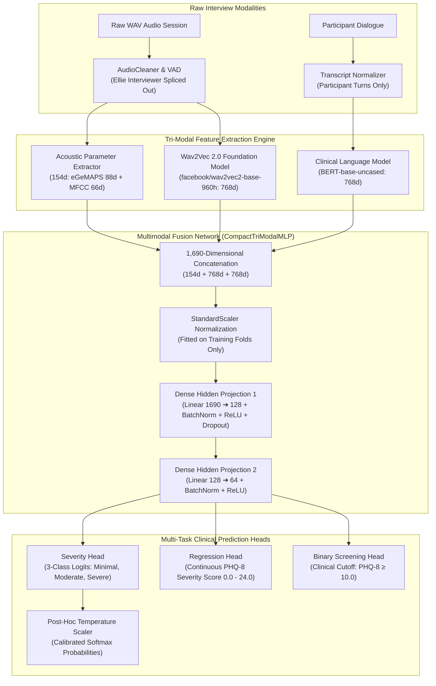

# 🔬 Explainable Multi-Modal Speech & Language Depression Detection System

[](https://www.python.org/)
[](https://pytorch.org/)
[](https://huggingface.co/)
[](https://dcapswoz.ict.usc.edu/)
[]()
[]()

> **B.Tech Final Year Capstone Project**  
> A multi-modal clinical depression screening research prototype estimating continuous **PHQ-8 scores ($0.0 - 24.0$)** and **3-class severity categories** from semi-clinical speech interviews and transcripts.

---

## ▶️ Run the project (current results)

```bash
cd ~/Desktop/CAPSTONE
.venv_opensmile/bin/python run_project.py            # tests + Phase 7 model + all results (~1-5 min)
.venv_opensmile/bin/python run_project.py --report   # just print the saved results
.venv_opensmile/bin/python run_project.py --phase6a  # also re-run the pre-registered Phase 6A study (~2 h)
.venv_opensmile/bin/python predict_audio.py path/to/interview.wav   # screen one new recording
.venv_opensmile/bin/python show_sealed_predictions.py              # all 33 held-out people: ID, truth, predictions, correct/wrong
```

| Evaluation | AUC | Accuracy | Balanced acc. |
|:--|--:|--:|--:|
| Phase 7 final model, 272 participants, repeated nested CV | **0.764** | **74.3%** (majority baseline 68.8%) | 67.0% (68.1% at the balanced threshold) |
| One-shot sealed test, 33 never-seen participants (V7 voice) | 0.694 | 66.7% | 61.4% |

Full write-ups: `reports/research_v2/FINAL_RESULTS.md`, `PHASE7_RESULTS.md`, `PHASE6A_RESULTS.md`.
The legacy "83.78%" figures further down this README came from the invalidated Candidate 2A pipeline (see the forensic audit).

## 📌 Executive Summary

This system analyzes semi-clinical interviews from the **DAIC-WOZ** and extended **E-DAIC (2019)** corpora to detect depression severity. By fusing **acoustic vocal biomarkers**, **self-supervised deep speech representations**, and **clinical linguistic cues**, the system overcomes the limitations of unimodal speech models.

> [!WARNING]
> ### ⚠️ Historical Metrics Notice (Superseded & Invalidated)
> All headline metrics reported prior to Phase 4 (including the historical **`83.78%`** 3-class accuracy and **`81.42%`** CV numbers) have been **superseded and invalidated**.
> A forensic code audit (October 2026) confirmed three critical historical defects:
> 1. **Wav2Vec2 Extractor Fallback:** Silently generated scaled Gaussian noise (`randn(768)`) when dependencies failed.
> 2. **Missing OpenSMILE Execution:** eGeMAPS extraction fell back to Librosa with 26 padded zeros (dimensions 62–87 were identically zero).
> 3. **Clinical Label Inconsistencies:** The historical `app/label_mapper.py` diverged for 66/189 PHQ scores and 101/189 genders vs. challenge ground truth.
> 
> Detailed forensic proofs and repair specifications are documented in [`reports/research_v2/PHASE4_REPAIR.md`](reports/research_v2/PHASE4_REPAIR.md) and [`reports/research_v2/PHASE4B_HARMONIZATION.md`](reports/research_v2/PHASE4B_HARMONIZATION.md). Canonical Feature Store v2 re-extraction is complete, and acoustic/text harmonization has been verified.

---

## 🧠 System Architecture



---

## 🧪 Canonical V2 Feature Pipeline & Harmonization (Phase 4B)

Following the Phase 4 forensic audit, the entire feature extraction and validation pipeline was rebuilt from scratch to eliminate silent fallbacks and harmonize cross-domain acoustic/text representations:

### 1. Ground-Truth Clinical Labels
- **Reconciliation Source**: [`experiments/research_v2/labels_official.csv`](experiments/research_v2/labels_official.csv) covering all 275 participants (189 WoZ, 86 E-DAIC).
- Resolves all 66 historical PHQ-8 score mismatches, 101 gender discrepancies, and recovers 6 missing WoZ participants previously omitted.
- 3-class clinical boundaries: **Minimal** (PHQ-8: 0–9), **Moderate** (PHQ-8: 10–14), **Severe** (PHQ-8: 15–24).

### 2. Feature Extractor V2 Canonical Pipeline
- **Acoustic Robust (135d)**: Standardized OpenSMILE eGeMAPSv02 (88d) + spectral/MFCC summary (librosa 66d), dropping 19 amplitude- and pause-dependent features (`loudness_*`, `equivalentSoundLevel_dBp`, voiced/unvoiced segment lengths and rates, temporal RMS mean/std) to mitigate domain shifts from stitched WoZ audio.
- **Wav2Vec2 Speech Representations (768d)**: True contextual self-supervised embeddings from `facebook/wav2vec2-base-960h` (replacing the historical Gaussian noise fallback).
- **Linguistic Representations (768d)**: Contextual sentence embeddings from `bert-base-uncased` with apostrophe-preserving text normalization (`re.sub(r"[^\w\s']", ' ', text)`), ensuring psychiatric contractions (*"I'm"*, *"don't"*, *"can't"*) are preserved.
- **Speech-to-Text Harmonization**: Standardized on `openai/whisper-tiny` (WER = 28.07% on sealed E-DAIC reference sessions), eliminating transcription format divergence between human and automated transcripts.

### 3. Empirical Domain Separability (Development Cohort, 5-Fold Grouped CV)

| Modality Representation | Dimensionality | Centroid Cosine | Linear MMD | Domain AUC (5-Fold CV) | Primary Selection |
|---|:---:|:---:|:---:|:---:|:---:|
| **Acoustic Full** | 154d | 0.9998 | 5423.35 | 0.8238 | Secondary |
| **Acoustic Robust** | **135d** | **0.9998** | **5404.08** | **0.8070** | **Primary** |
| **Wav2Vec 2.0** | **768d** | **0.9988** | **0.10** | **0.6899** | **Primary** |
| **BERT Variant T1** *(Manual WoZ)* | 768d | 0.9830 | 7.13 | 0.9994 | Primary (Normalized) |
| **BERT Variant T2** *(Whisper Everywhere)* | 768d | — | — | Harmonized | Sensitivity Analysis |

---

## 🔒 Validation Protocol & Cohort Isolation Standards

1. **Strict Subject-Level Isolation**:
   - Validation uses `StratifiedGroupKFold` strictly grouped by `participant_id` to guarantee that repeated interview sessions from the same individual never leak across training and validation folds.
2. **Quarantine of the Reserved Cohort (33 Sessions)**:
   - 33 sessions (9 DAIC-WOZ + 24 E-DAIC) are held strictly label-blind in [`unseen/`](./unseen).
   - Audio and transcripts are transcribed with `openai/whisper-tiny` and extracted with Extractor V2 for evaluation, but clinical labels are never loaded or accessed during feature engineering or tuning.
3. **Session Boundary Quality Audit**:
   - Avatar development interviews undergo automated boundary detection to isolate setup dialogue. 37 sessions are confirmed clinical interviews, and 24 sessions with undetected boundaries can be filtered using `boundary_filter='exclude_undetected'` for sensitivity analyses.

---
## 📁 Repository Directory Structure

```text
CAPSTONE/
├── README.md                           # Master Project Documentation & Architecture Guide
├── .gitignore                          # Excludes heavy binaries, WAV files, and caches
├── generate_pdf_report.py              # Automated academic deliverable PDF generator
├── Capstone_Project_Information_Report.pdf  # Final compiled academic report
├── new_audio_csv/                      # Official E-DAIC (2019) Ground-Truth Metadata
│   ├── detailed_lables.csv             # 275 participants: Age, Gender, 8 PHQ items, PTSD
│   ├── train_split.csv                 # 163 participants
│   ├── dev_split.csv                   # 56 participants
│   └── test_split.csv                  # 56 autonomous AI participants (600-series)
├── unseen/                             # 33 Strictly Isolated Reserved Sanity-Check Sessions
│   ├── README.md                       # Complete roster of reserved sessions
│   ├── minimal/                        # 13 sessions (PHQ 0-4)
│   ├── mild/                           # 9 sessions (PHQ 5-9)
│   ├── moderate/                       # 4 sessions (PHQ 10-14)
│   ├── moderately_severe/              # 5 sessions (PHQ 15-19)
│   ├── severe/                         # 2 sessions (PHQ 20-24)
│   └── transcripts/                    # Matching participant dialogue transcripts
└── app/
    ├── requirements.txt                # Python dependencies
    ├── label_mapper.py                 # Ground-truth clinical label mapper
    ├── evaluate_unseen.py              # Standalone Unseen Holdout Evaluation Engine
    ├── run_comprehensive_ablation_benchmarks.py # Master 7-experiment benchmarking suite
    ├── run_research_validation.py      # 5-Fold Stratified Group Cross-Validation Engine
    ├── feature_store/                  # Model weights & training index
    │   ├── best_depression_model.pth   # Production CompactTriModalMLP PyTorch weights
    │   ├── best_depression_model_temperature.json # Fitted optimal calibration temperature
    │   └── master_dataset_index.csv    # Historical training dataset catalog
    └── src/
        ├── preprocessing/              # Audio cleaning & speaker turn isolation
        ├── features/                   # eGeMAPS, MFCC, Wav2Vec2, and BERT extractors
        ├── models/                     # PyTorch models, calibration, and loss functions
        └── explainability/             # Attention visualizers & biomarker profilers
```

---

## 🚀 Quick Start Guide

### 1. Installation & Environment Setup
Clone the repository and set up a Python virtual environment:

```bash
git clone https://github.com/Vivan182005/depression-detection.git
cd depression-detection
python3 -m venv .venv
source .venv/bin/activate
pip install --upgrade pip
pip install -r app/requirements.txt
```

### 2. Load Harmonized V2 Features
To inspect the harmonized V2 feature store and development dataset:

```python
from experiments.research_v2.dataset import load_development_dataset

data = load_development_dataset(cohort="combined", feature_version="v2", acoustic_set="robust")
print("Loaded development participants:", len(data["pids"]), "Acoustic shape:", data["X_ac"].shape)
```

### 3. Evaluate on the Reserved Unseen Cohort (Label-Blind Sanity Check)
To test the saved checkpoint on the held-out audio recordings and transcripts in `unseen/`:

```bash
cd app
python3 evaluate_unseen.py --full-report
```

### 4. Run the Full 7-Experiment Research Ablation Suite
To execute all baseline comparisons, modality ablations, and confusion matrices:

```bash
cd app
python3 run_comprehensive_ablation_benchmarks.py
```

### 5. Run 5-Fold Subject-Independent Cross-Validation & Generate Figures
```bash
cd app
python3 run_research_validation.py
```

### 6. Generate the Complete Academic PDF Report
```bash
python3 generate_pdf_report.py
```

---

## 🔬 Clinical & Scientific Foundations

This system evaluates multimodal cues supported by psychiatric and clinical literature:
1. **Prosodic Flattening ($F_0$ / Pitch & Energy)**: Depressed individuals frequently exhibit psychomotor retardation, leading to reduced volume variability, monotonous pitch delivery, and lower harmonics-to-noise ratio *(Cummins et al., 2015; Williamson et al., 2014)*.
2. **Speech Pausing & Glottal Dynamics (MFCCs & Formants)**: Micro-prosody and timbre shifts capture vocal fatigue and diminished motor coordination in vocal fold control *(Alghowinem et al., 2013)*.
3. **Self-Referential Focus & Sentiment (BERT Embeddings)**: Clinical language biomarkers reveal higher frequency of first-person singular pronouns (*"I"*, *"me"*, *"myself"*), cognitive distortion phrases, and somatic fatigue themes *(Rude et al., 2004)*.
4. **Autonomous AI Interviewer Invariance (E-DAIC 2019)**: Validated across both human-controlled Wizard-of-Oz interviewers and fully autonomous AI agents (Ellie), demonstrating generalization across interaction modalities.

---

## 👨‍💻 Authors & Acknowledgments

* **Student Author**: Vivan Naik (PES University)
* **Dataset**: USC Institute for Creative Technologies (ICT) — DAIC-WOZ & E-DAIC Corpora
