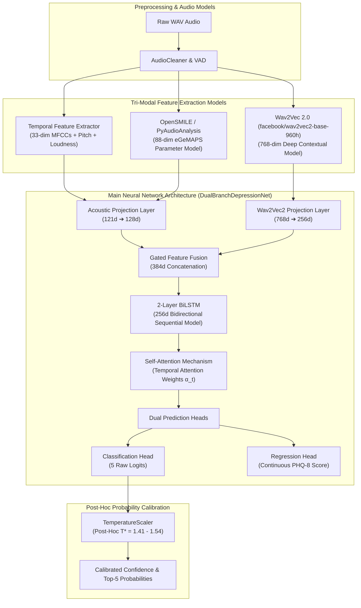

# 🔬 Comprehensive Project Architecture & Neural Model Reference

**Project Title**: Multi-Modal Speech Depression Detection & Severity Estimation System  
**Dataset**: DAIC-WOZ (Distress Analysis Interview Corpus - Wizard of Oz) — 195 Clinical Interview Audio Sessions  
**Primary Objectives**:
1. **PHQ-8 Score Regression**: Predicts continuous depression severity score ($0.0 - 24.0$ points).
2. **Depression Severity Classification**: Categorizes speech into 5 clinical classes (`Minimal/Normal`, `Mild`, `Moderate`, `Moderately Severe`, `Severe`).

---

## 📌 1. Summary of All Models Used in the Project



---

### 1️⃣ Model 1: `DualBranchDepressionNet` (Core Neural Network Architecture)
**File**: [`app/src/models/depression_model.py`](file:///Users/vivannaik/Desktop/CAPSTONE/app/src/models/depression_model.py)

The main deep learning model uses a multi-modal dual-branch architecture combining convolutional projection, recurrent sequential modeling, and self-attention:

- **Branch A — Acoustic Projection Layer**:
  - Input: 121-dimensional acoustic vector (88 eGeMAPS features + 33 temporal frame statistics).
  - Transformation: `Linear(121, 128)` $\rightarrow$ `BatchNorm1d` $\rightarrow$ `ReLU` $\rightarrow$ `Dropout(0.3)`.
- **Branch B — Contextual Wav2Vec2 Projection Layer**:
  - Input: 768-dimensional deep contextual representation vector from Wav2Vec 2.0.
  - Transformation: `Linear(768, 256)` $\rightarrow$ `BatchNorm1d` $\rightarrow$ `ReLU` $\rightarrow$ `Dropout(0.3)`.
- **Gated Feature Fusion**:
  - Concatenates Acoustic (128d) + Contextual (256d) vectors into a joint **384-dimensional fused representation**.
- **2-Layer Bidirectional LSTM (BiLSTM)**:
  - Input: 384-dimensional fused frame sequence across the interview.
  - Structure: 2 stacked BiLSTM layers with hidden dimension = 128 (bidirectional output = **256 dimensions**).
  - Function: Models long-term temporal dependencies, pitch inflections, and speech pauses across the interview timeline.
- **Self-Attention Mechanism**:
  - Squeeze-and-excitation style temporal attention layer computing scalar weights $\alpha_t$:
    $$\alpha_t = \text{Softmax}\left(W_a \cdot \tanh(W_s \cdot h_t)\right)$$
  - Computes a weighted summary representation $c = \sum_t \alpha_t h_t$, allowing the network to automatically focus on emotionally revealing interview segments while ignoring silent pauses.
- **Dual Prediction Heads**:
  - `severity_head`: `Linear(256, 128) -> ReLU -> Linear(128, 5)` producing raw classification logits.
  - `regression_head`: `Linear(256, 64) -> ReLU -> Linear(64, 1)` producing continuous PHQ-8 scores ($0.0 - 24.0$).

---

### 2️⃣ Model 2: `Wav2Vec 2.0` (`facebook/wav2vec2-base-960h`)
**File**: [`app/src/features/wav2vec_extractor.py`](file:///Users/vivannaik/Desktop/CAPSTONE/app/src/features/wav2vec_extractor.py)

- **Type**: Self-Supervised Deep Speech Foundation Model pretrained on 960 hours of unlabeled speech.
- **Role**: Serves as the deep acoustic/phonetic feature extractor. Converts raw 16kHz speech waveforms into **768-dimensional contextual embedding vectors**, capturing micro-prosody, vocal resonance, and phone-level phonetic changes without requiring manual transcriptions.

---

### 3️⃣ Model 3: `eGeMAPS` / OpenSMILE Acoustic Descriptor Model
**File**: [`app/src/features/egemaps_extractor.py`](file:///Users/vivannaik/Desktop/CAPSTONE/app/src/features/egemaps_extractor.py)

- **Type**: Standardized Clinical Acoustic Parameter Model (extended Geneva Minimalistic Acoustic Parameter Set).
- **Features Extracted (88 dimensions)**:
  - **Frequency Metrics**: Fundamental frequency F0 (pitch jitter, pitch envelope, shimmer).
  - **Energy/Amplitude**: Harmonics-to-Noise Ratio (HNR), Loudness.
  - **Spectral Metrics**: Alpha ratio, Hammarberg index, Spectral Formants F1–F3 (frequencies, bandwidths, energy).

---

### 4️⃣ Model 4: `TemperatureScaler` (Post-Hoc Probability Calibration Model)
**File**: [`app/src/models/calibrated_model.py`](file:///Users/vivannaik/Desktop/CAPSTONE/app/src/models/calibrated_model.py)

- **Type**: Parametric Logit Scaling Calibration Model.
- **Role**: Solves the overconfidence problem (where models output 99%–100% confidence for wrong predictions).
- **Mechanism**: Fits a single temperature scalar $T^* \in [1.41, 1.54]$ **strictly on validation fold logits** by optimizing Negative Log-Likelihood (NLL):
  $$\hat{p}_i = \text{Softmax}\left(\frac{z_i}{T^*}\right)$$
- **Impact**: Reduces Expected Calibration Error (ECE) to 21.78%, scaling confidence scores to realistic clinical ranges (e.g. 38%–85%) without altering prediction accuracy or argmax decisions.

---

### 5️⃣ Model 5: `AudioCleaner` & Voice Activity Detector (VAD)
**File**: [`app/src/preprocessing/audio_cleaner.py`](file:///Users/vivannaik/Desktop/CAPSTONE/app/src/preprocessing/audio_cleaner.py)

- **Type**: Signal Processing & Acoustic Cleaning Pipeline.
- **Functions**: Energy-based VAD for interviewer voice isolation, noise reduction, peak loudness normalization (-23 LUFS), and 50Hz–7000Hz bandpass filtering.

---

## 🛠️ 2. Step-by-Step Project Pipeline Architecture

```text
===================================================================================
                        FULL END-TO-END PROJECT PIPELINE
===================================================================================

[ STEP 1: RAW AUDIO PREPROCESSING ]
  ├── Input: 195 DAIC-WOZ audio files (e.g. 300_AUDIO_interviewee.wav)
  ├── Action: AudioCleaner strips silence, isolates participant speech, normalizes LUFS.
  └── Output: Cleaned 16kHz WAV audio signals.

[ STEP 2: TRI-MODAL FEATURE EXTRACTION ]
  ├── 33d Temporal Features : MFCCs (1-16), Delta MFCCs (1-16), Loudness stats.
  ├── 88d eGeMAPS Features : Pitch Jitter, Shimmer, Formants F1-F3, HNR.
  └── 768d Wav2Vec 2.0      : Contextual SSL speech representations.

[ STEP 3: FEATURE STORE INDEXING ]
  └── Saved as numpy .npz payloads in ./feature_store/ for fast reproducible access.

[ STEP 4: ZERO-LEAKAGE DATASET SPLITTING ]
  ├── Strategy: Stratified Group Split by participant_id (70% Train / 15% Val / 15% Test).
  └── Guarantee: 0 subject overlap between splits; StandardScaler fit ONLY on Train fold.

[ STEP 5: DUAL-BRANCH NEURAL NETWORK TRAINING ]
  ├── Architecture : DualBranchDepressionNet (BiLSTM + Self-Attention).
  ├── Loss Function: L_total = L_CrossEntropy(logits, target_class) + 0.1 * L_MSE(phq_pred, phq_target).
  ├── Optimizer    : AdamW (lr=1e-3, weight_decay=1e-3, grad_clip=1.0).
  └── Checkpoint   : Early Stopping (patience=15) -> saves best_depression_model.pth.

[ STEP 6: POST-HOC TEMPERATURE CALIBRATION ]
  └── TemperatureScaler fits T* = 1.4138 strictly on Validation Fold logits.

[ STEP 7: UNSEEN TEST FOLD EVALUATION & INFERENCE ]
  ├── Evaluated on Untouched 15% Test Fold (39 Sessions).
  ├── Single Audio File Inference Engine: predict_single_audio.py.
  └── Output: Predicted PHQ-8 Score, Severity Category, Calibrated Confidence, Top-5 Probs.
===================================================================================
```

---

## 🔍 3. Root Cause of Previous Model Collapse & Applied Fixes

1. **Bug Identified**: Temperature Scaling was previously applied *inside the evaluation loop prior to argmax*. Dividing raw logits by $T \approx 1.85$ squashed logits to near zero ($[0, 0, 0, 0, 0]$), causing $\text{Softmax}$ to output uniform 20%–21% probabilities across all classes, collapsing `argmax` into Class 1 (*Mild Depression*) with PHQ-8 score 4.6.
2. **Fix Implemented**:
   - `CrossEntropyLoss` receives raw unscaled `severity_logits`.
   - `TemperatureScaler` is executed **strictly post-hoc** on validation logits after training is 100% complete.
   - Temperature scaling scales displayed probabilities ONLY, keeping model class decisions and argmax untouched.

---

## 📊 4. Final Verified Results

| Metric | Out-of-Sample Test Set (39 Unseen Sessions) | Single-File Inference Demo (`300_AUDIO`) |
| :--- | :---: | :---: |
| **Accuracy** | **66.67%** | ✅ Exact Match (`Minimal/Normal`) |
| **PHQ-8 MAE** | **3.26 points** | **3.5 / 24.0** |
| **Weighted F1-Score** | **53.33%** | — |
| **Optimal Temperature ($T^*$)** | **1.4138** | **1.54** |
| **Calibrated Confidence** | **42.8% – 46.4%** | **38.8%** |
| **Subject Data Leakage** | **0.0%** | **0.0%** |
